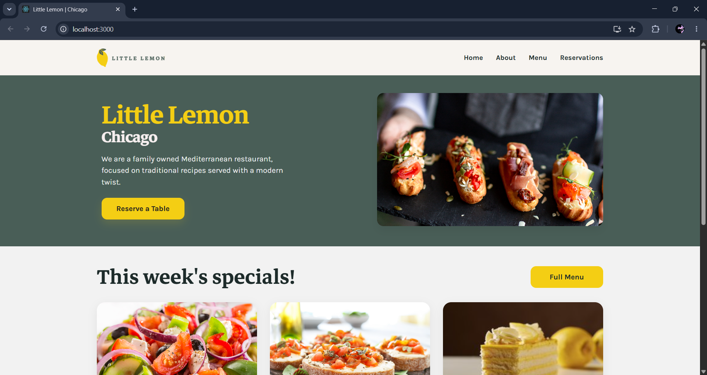
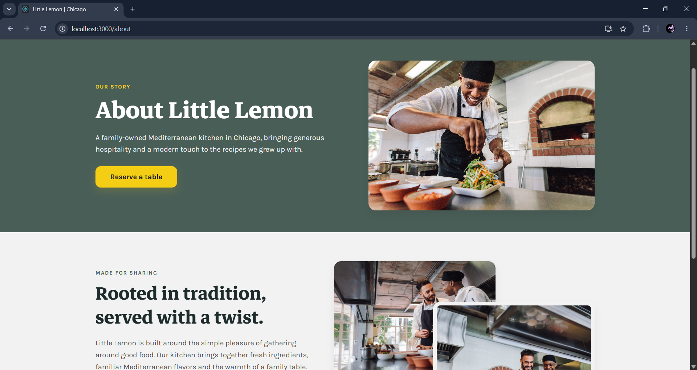
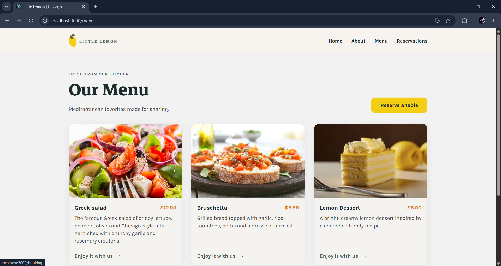
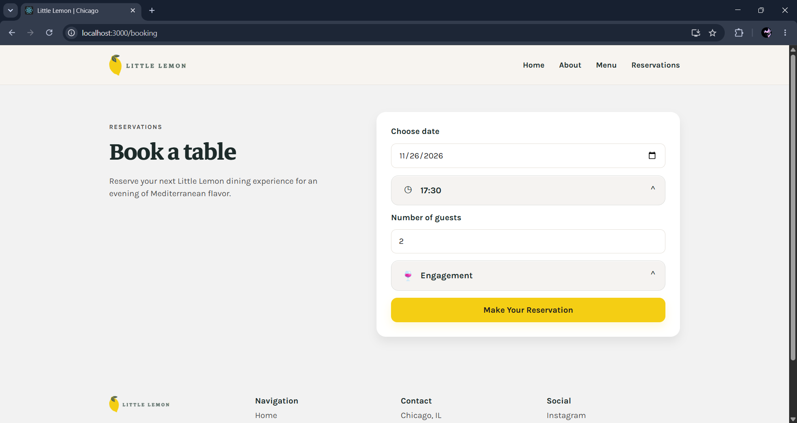
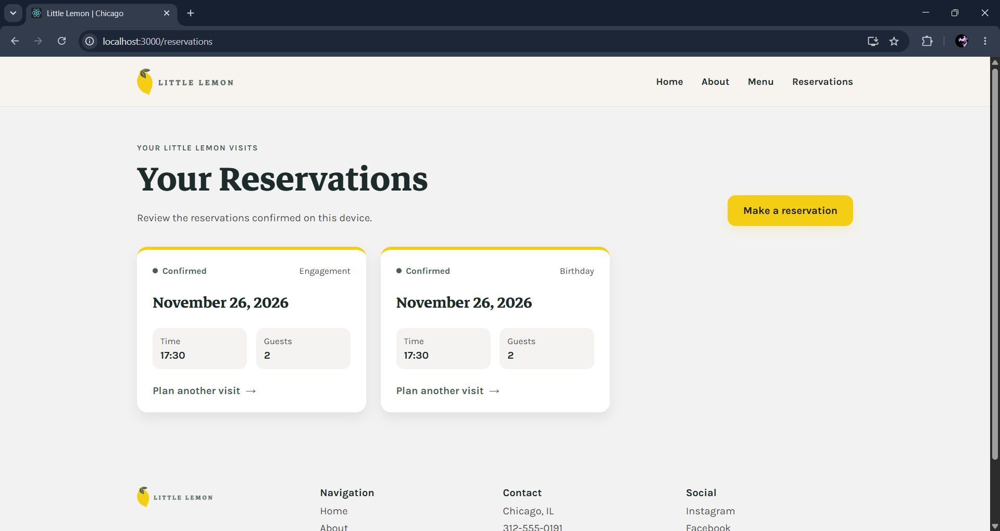
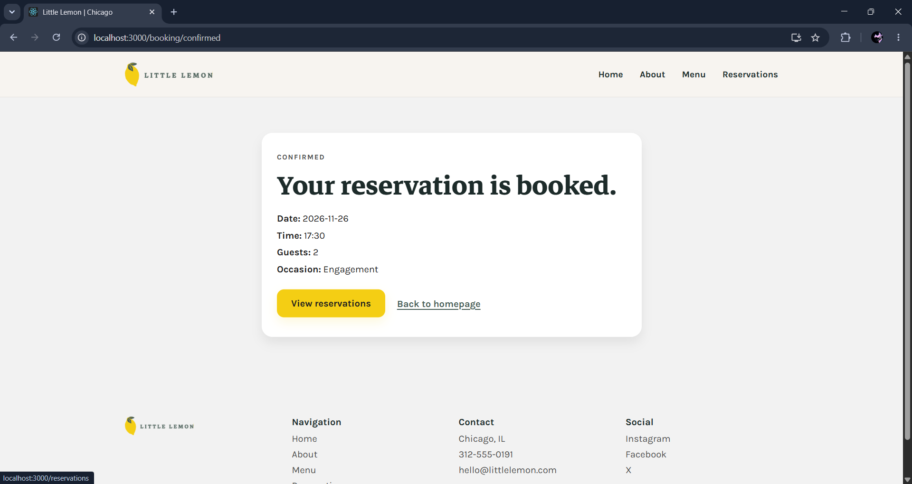

# 🍋 Little Lemon — Meta Front-End Developer Capstone

A responsive restaurant website for **Little Lemon**, a family-owned Mediterranean restaurant in Chicago. Explore the restaurant story and menu, reserve a table, and review reservations confirmed in your browser.

---

## ✨ Project Highlights

- 📱 Responsive layouts with mobile navigation
- 🍽️ Dedicated Home, About, Menu, Booking, Confirmation, and Reservations pages
- 📅 Reservation form with date-based availability from the Little Lemon booking API
- ✅ Form validation and clear submission feedback
- 🗂️ Reservations page showing bookings saved in the current browser
- ♿ Semantic page structure, labeled form controls, keyboard-operable navigation, and visible focus states
- 🎨 Little Lemon design system with Mediterranean green, lemon yellow, rounded cards, and responsive typography

---

## 📸 Demo Screenshots

<table>
  <tr>
    <td align="center">
      
      <p><strong>Home</strong></p>
    </td>
    <td align="center">
      
      <p><strong>About</strong></p>
    </td>
  </tr>
  <tr>
    <td align="center">
      
      <p><strong>Menu</strong></p>
    </td>
    <td align="center">
      
      <p><strong>Booking</strong></p>
    </td>
  </tr>
  <tr>
    <td align="center">
      
      <p><strong>Reservations</strong></p>
    </td>
    <td align="center">
      
      <p><strong>Booking Confirmation</strong></p>
    </td>
  </tr>
</table>

---

## 🧠 Overview

Little Lemon brings the restaurant's menu and reservation flow together in one responsive website. Visitors can:

- Learn about the restaurant and its Mediterranean-inspired story
- Browse menu items and prices
- Choose a reservation date, available time, party size, and occasion
- Submit a booking and view a confirmation
- Review reservations confirmed on the same browser

---

## 🧩 Features

- Shared navigation and footer across the application
- Responsive mobile burger menu with animated transitions
- API-driven available reservation times that update when the selected date changes
- Native and client-side booking validation
- Confirmation page shown after successful API submission
- Browser `localStorage` persistence for confirmed reservation cards
- Open Graph and page description metadata
- Existing project assets used for restaurant imagery and branding

> **Reservation storage note:** the supplied booking API confirms submissions but does not provide a reservation-history endpoint. The Reservations page therefore shows only bookings saved locally in the current browser; it does not sync between devices or accounts.

---

## 🧱 Architecture

- **Application shell:** React Router routes, shared header, main content, and footer
- **Pages and components:** focused React components for Home, About, Menu, Booking, Confirmation, and Reservations
- **Booking state:** `useReducer` manages date-based available times
- **Booking API:** the supplied Little Lemon API provides availability and submission functions
- **Reservation history:** browser `localStorage` stores successful booking details for the Reservations page
- **Styling:** responsive CSS with shared Little Lemon design tokens and component styles

---

## 🛠️ Tech Stack

- **Frontend:** React 19
- **Routing:** React Router
- **Styling:** CSS
- **Booking API:** Little Lemon course API (`fetchAPI` and `submitAPI`)
- **Testing:** Jest and React Testing Library
- **Build tooling:** Create React App (`react-scripts`)

---

## 🚀 Getting Started

### Prerequisites

- Node.js and npm

### Install dependencies

```bash
npm install
```

### Start the development server

```bash
npm start
```

The app opens at [http://localhost:3000](http://localhost:3000).

### Run tests

```bash
npm test -- --watch=false
```

### Create a production build

```bash
npm run build
```
